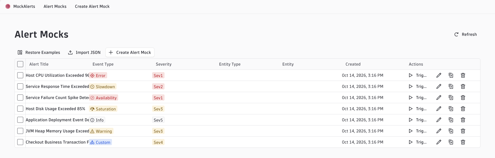
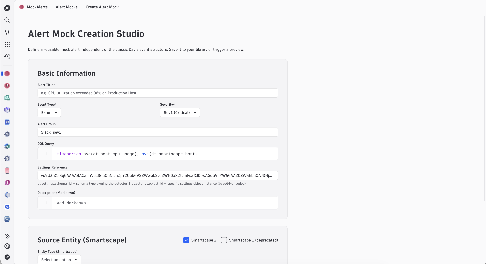
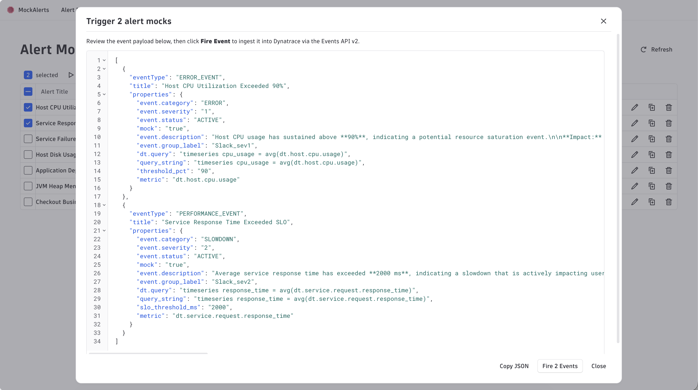

# MockAlerts

MockAlerts is a Dynatrace app for triggering mocked alert events on demand. Use it to test Dynatrace root-cause analysis, alert delivery, and Workflow automations without waiting for a real problem to occur.

Mock alerts are stored in the app's state, so you can build a library of reusable templates and fire them whenever you need them.

## Features

- **Mock alert templates**: Create your own alert templates with a title, event type, severity, alert group, DQL query, settings reference, and a Markdown description.
- **Smartscape references**: Attach Smartscape entities (Smartscape 2) to a template so the triggered alert points at a real topology node.
- **Trigger single or multiple alerts**: Select one or more templates and fire them in a single action to simulate more complex situations, such as a cascading failure across several services.
- **Event payload preview**: Review the exact Events API v2 payload before it is sent, then fire it or copy it.
- **Curl and SDK output**: Get the equivalent `curl` command to trigger the same alerts through the API, or the Dynatrace JavaScript SDK snippet.
- **Import and export**: Export your templates as JSON and import them into another tenant.
- **Restore examples**: Load a set of ready-made example templates (host CPU, service response time, availability, disk saturation, JVM heap, and more).

## Screenshots

**Alert Mock Creation Studio**: define a reusable mock alert, including its DQL query and Smartscape source entity.

**Trigger preview**: review the generated event payload for the selected alerts, then fire them or copy the JSON.

## Installation

1. Download [MockAlertsApp.zip](./MockAlertsApp.zip).
2. Deploy the app to your Dynatrace environment using your usual app deployment process.
3. Open **MockAlerts** from the Dynatrace app menu.

The app requests the following scopes: `storage:events:write` (to ingest events), `storage:logs:read`, `storage:buckets:read`, `storage:entities:read`, `storage:smartscape:read` (for Smartscape lookups), and `state:app-states:read` / `state:app-states:write` (to persist the template library).

## Usage

1. Go to **Create Alert Mock** and define the alert: title, event type, severity, alert group, and DQL query. Optionally select a Smartscape source entity and add a description.
2. Save the template. It appears in **Alert Mocks**.
3. Select one or more templates and click **Trigger**.
4. Review the payload and click **Fire Events**, or copy the JSON, the `curl` command, or the SDK snippet and run it elsewhere.
5. To move templates between tenants, export them as JSON from the source tenant and use **Import JSON** on the target tenant.

## Disclaimer

This app is a personal experiment provided as-is, without warranty or official Dynatrace support. It is not an official Dynatrace product. Use it only in environments where injecting mock events is acceptable.
